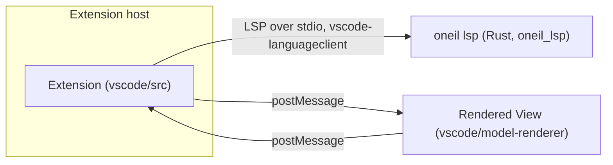

# VS Code Extension Architecture

The VS Code extension in [`vscode/`](../../vscode/) gives editors Oneil support. It does not contain an Oneil implementation of its own: every language feature comes from the `oneil lsp` language server, and the Rendered View displays data the server computes. This document describes the extension's parts and the contracts between them. Contributor setup and publishing live in [`vscode/docs/CONTRIBUTING.md`](../../vscode/docs/CONTRIBUTING.md).

## Processes

- **Extension host:** TypeScript in `vscode/src`, bundled by esbuild into `out/extension.js` and activated on startup. It finds the CLI, starts the language server, and hosts the Rendered View panel. It also provides a few editor features that don't need the compiler (see [Extension-only features](#extension-only-features)).
- **Language server:** the `oneil lsp` subcommand of the CLI, implemented by `oneil_lsp` on top of `oneil_runtime`. It is a child process of the extension host and serves both `oneil` and `python` documents, so the server can see edits to imported Python files.
- **Webview:** a React app in `vscode/model-renderer`, built by Vite into `out/model-renderer/`. It runs sandboxed and talks only to the extension host, never to the language server.

## Finding the CLI

`vscode/src/cli/resolve.ts` picks the binary in this order:

1. the `oneil.serverPath` setting;
2. the extension-managed binary in the extension's global storage, downloaded from GitHub Releases;
3. the `ONEIL_PATH` environment variable;
4. `oneil` on `PATH`.

The managed binary is downloaded for the current platform and for the Python 3.12 layout found on the machine. Update checks are skipped when `oneil.serverPath` is set. The reasoning is recorded in [the extension-managed CLI decision](../decisions/2026-08-12-extension-managed-cli.md) and [the portable macOS Python decision](../decisions/2026-08-14-portable-macos-cli-python.md).

The extension passes the cache-policy and workspace-discovery settings to `oneil lsp` as command-line flags, and restarts the server when those settings change.

## Language server contract

The server provides the standard features through `vscode-languageclient`: diagnostics, hover, go to definition, references, document highlights, and rename. Which compiler phase each feature runs is listed in [the compiler pipeline doc](compiler-pipeline.md#which-entry-points-stop-where). Diagnostics are refreshed when a file is opened or saved, not while the user types.

One custom command exists: `oneil/instanceTree`, sent as `workspace/executeCommand` with the document URI as its only argument. The server (`oneil_lsp/src/custom_requests.rs`) fully evaluates the model and returns a `RenderedTree`: the evaluated instance tree with its IR metadata (expressions, notes, sections, design provenance). The payload is defined in [the Rendered View schema decision](../decisions/2026-05-07-rendered-view-json-schema.md).

A new custom request should be a new `workspace/executeCommand` command. Advertise it in the server's capabilities, and put its payload types in Rust so they become [wire types](#wire-types).

## Wire types

The Rust types that cross the language-server boundary are the source of truth.

- They derive `serde` and, behind the `ts-bindings` feature, `ts-rs`.
- `scripts/generate-ts-interfaces.sh` exports them to [`packages/ts-interfaces`](../../packages/ts-interfaces/README.md) (the `oneil-ts-interfaces` npm package). The pre-commit hook runs it, and the `ts-interfaces` CI workflow fails if the committed output is out of date.
- The renderer depends on that package, and `model-renderer/src/types/model.ts` re-exports it. Never edit `packages/ts-interfaces/src/generated/` by hand.

The messages between the extension host and the webview are not generated. They are written by hand in `model-renderer/src/types/messages.ts` and must be kept in sync with `vscode/src/webview/panel.ts`:

- **Host to webview:** `loading`, `instanceTree` (the `RenderedTree` plus the bibliography and the webview URIs for the workspace, the file's directory, and the PDF cache), and `error`.
- **Webview to host:** `ready`, `reload`, and `openPdf`.

## Rendered View lifecycle

`vscode/src/webview/panel.ts` owns the single Rendered View panel and its lifecycle. It follows the active Oneil editor, and it fetches a fresh `RenderedTree` when:

- the webview reports `ready` (its message listener is attached) or asks for `reload`;
- the panel goes from hidden to visible (gaining focus while already visible does not refresh);
- the active editor changes to an Oneil file, which also re-targets the panel;
- any Oneil file is saved, since a dependency can change the root model's results;
- the user runs `Oneil: Open Rendered View` again or `Oneil: Reload Rendered View`.

The renderer keeps its state in Jotai atoms under `model-renderer/src/store/atoms`. The store is created once when the module loads, and `services/messageService.ts` is initialised before React renders, so no message from the host can arrive before the listener exists. The renderer uses `fileUri` to tell a switch to a different file (which resets the selection and panel state) from a refresh of the same file (which keeps it).

The main renderer libraries are React, Jotai, styled-components, KaTeX (equations), `marked` (Markdown in notes), `citation-js` (citations), React Flow (the model graph), and `react-pdf` (cited PDFs).

## Extension-only features

These run in the extension host without the language server:

- **Bibliography lookup** (`src/bibliography/`): finds `references.bib` (and other `.bib` files) next to the model or at the workspace root, and sends the text to the webview.
- **PDF cache** (`src/pdf/`, `src/webview/pdfPanel.ts`): downloads cited PDFs into a local cache, with an offline-only mode.
- **Note asset diagnostics** (`src/diagnostics/imagePaths.ts`): warns about missing images and PDFs referenced from notes.

## Syntax highlighting

Highlighting comes from the TextMate grammar `vscode/syntaxes/oneil.tmLanguage.json`. Notes are highlighted by hand-written Markdown patterns inside that grammar rather than by embedding the built-in Markdown grammar, which conflicts with the `~~~` note delimiter and with indented note content. [The proposal to fork the Markdown grammar](../decisions/2026-05-13-fork-markdown-textmate-grammar.md) describes these limits and a fuller replacement. Semantic understanding (definitions, errors) always comes from the language server, never from the grammar.

## Build, test, and CI

- **Package manager:** npm, with separate `package-lock.json` files in `vscode/` and `vscode/model-renderer/`.
- **Extension:** `npm run bundle` (esbuild), `npm run lint` (ESLint), and `npm test` (Vitest, for the CLI management and PDF cache logic). There are no tests that run inside VS Code.
- **Renderer:** `npm run build:webview` from `vscode/` (TypeScript check, then Vite), and `npm test` in `vscode/model-renderer/` (Vitest).
- **Packaging:** `vscode:prepublish` runs a production bundle and the webview build.
- **CI:** when the corresponding paths change, the workflows in `.github/workflows/` run the extension tests (`vscode-extension`), the renderer build and tests (`model-renderer`), and the generated-types check (`ts-interfaces`). Lint runs locally only.
