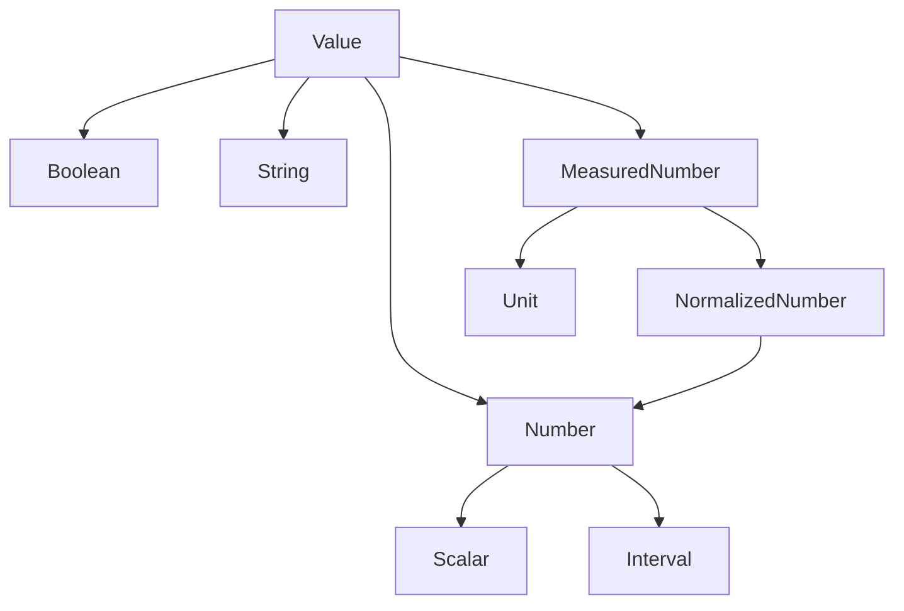

# Oneil Output

Output and value types for the Oneil programming language. This crate provides:

- **Output types**: Evaluated model results (parameters, tests, dependency sets).
- **Value types**: Runtime values (numbers, units, intervals, measured numbers, etc.).
- **Evaluation errors**: `EvalError` and `ModelEvalErrors`, including the type and unit mismatches found during evaluation.

These types are produced by the evaluator (`oneil_eval`) and consumed by the runtime and tooling. With the `ts-bindings` feature, the serializable types are exported to TypeScript through `ts-rs` (see `packages/ts-interfaces`).

## Oneil Values

An Oneil `Value` (in [`value.rs`](src/value.rs)) is a `Boolean`, a `String`, a unitless `Number`, or a `MeasuredNumber`.



A `Number` (in [`number_kinds/number.rs`](src/number_kinds/number.rs)) is either a `Scalar`, which has a single `f64` value, or an `Interval` (in [`interval.rs`](src/interval.rs)), which has a min and a max `f64` value.

A `MeasuredNumber` (in [`number_kinds/measured_number.rs`](src/number_kinds/measured_number.rs)) is composed of a `Unit` and a `NormalizedNumber`: a `Number` with the unit's magnitude (and dB scaling) already applied.

Each level has operations defined on it that perform checks appropriate to its level. Operations defined on `Value` check that the values have compatible types. Operations on `MeasuredNumber` check that `Unit`s are correct. Operations on `Number` handle whether each side is a `Scalar` or an `Interval`.

For example, `Value::checked_add` checks that both values are numbers of a compatible kind, then calls `MeasuredNumber::checked_add` for measured numbers. `MeasuredNumber::checked_add` checks that both numbers have the same dimensions before adding the underlying numbers.

Note that `Interval` operations are based on the research done on the topic, as well as the [`inari` crate](https://crates.io/crates/inari). A writeup of the research can be found in [`docs/research/2025-11-13-interval-arithmetic-paper-review.md`](../../docs/research/2025-11-13-interval-arithmetic-paper-review.md). We do not use the `inari` crate directly because it is specialized to certain CPUs.

## Float Comparison

Oneil uses `f64` to represent its values. Because of the way that floating point works, [comparison does not always produce the expected result](https://floating-point-gui.de/errors/comparison/). For example, [`0.1 + 0.2 != 0.3`](https://play.rust-lang.org/?version=stable&mode=debug&edition=2024&gist=0610a3521f8f8b8747258fb21adc0744).

For this reason, Oneil uses an `is_close` function that checks if floats are equal with a degree of uncertainty. This function uses absolute or relative uncertainty depending on the context. For more details, see the implementation in [`util.rs`](src/util.rs).

## Unit Handling

A `Unit` (in [`unit.rs`](src/unit.rs)) has a dimension map, a magnitude (for example 1000 for `km`), a flag for decibel units, and display information. The dimension map associates each `Dimension` with an `f64` exponent. Each dimension has a *base unit*:

| Dimension                      | Base Unit |
|--------------------------------|-----------|
| `Dimension::Mass`              | kilogram  |
| `Dimension::Distance`          | meter     |
| `Dimension::Time`              | second    |
| `Dimension::Temperature`       | Kelvin    |
| `Dimension::Current`           | Ampere    |
| `Dimension::Information`       | bit       |
| `Dimension::Currency`          | USD       |
| `Dimension::Substance`         | mole      |
| `Dimension::LuminousIntensity` | candela   |

So, for example, the dimension `kg*m/s^2` would be represented as:

```js
{
	Mass: 1.0,
	Distance: 1.0,
	Time: -2.0,
	// all other dimensions are zero
}
```

A unit is dimensionless if all of its dimensions are equal to zero.

A `MeasuredNumber` stores its value in normalized form, with the unit's magnitude applied. So

```oneil
My value: x = 10 :km
```

is stored as `10 * 1000` with the unit `km`. The unit's magnitude is kept with the unit so the value can be displayed in the units the user wrote.

## Fuzz Testing

Interval arithmetic is difficult to get right, so we use [fuzz testing](https://en.wikipedia.org/wiki/Fuzzing) to test properties of interval arithmetic, such as "interval arithmetic should always produce a valid interval".

Fuzz test targets are found in the [`fuzz/fuzz_targets`](fuzz/fuzz_targets/) directory, with shared data structures and code in [`fuzz/shared`](fuzz/shared/). CI runs each target for a fixed time on pull requests (`.github/workflows/rust-pr.yml`).

In order to run the fuzz tests, you will need to install the nightly compiler and `cargo-fuzz`.

```bash
$ rustup install nightly
$ cargo install cargo-fuzz
```

To run the fuzz tests, run

```bash
cargo +nightly fuzz run <fuzz-target>
```

from `src/oneil_output`, where `<fuzz-target>` is the name of the target, such as `single_op_inclusion_property`. This will run the fuzz test either until it finds an input that causes the test to panic or until you stop it with `Ctrl+C`.

For more details on fuzzing, see the [*Rust Fuzz Book*](https://rust-fuzz.github.io/book/cargo-fuzz/setup.html).
